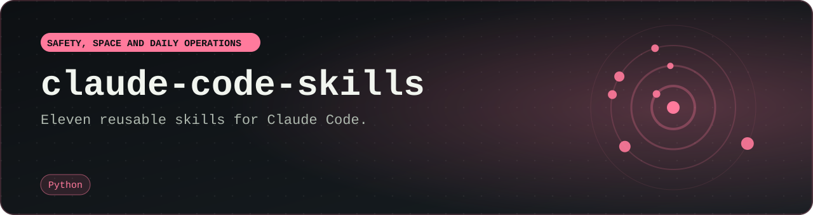
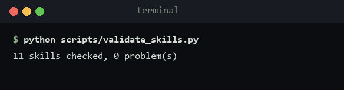

<p align="center"></p>

# claude-code-skills

[](https://github.com/yassine2med/claude-code-skills/actions/workflows/ci.yml)  

Eleven reusable skills for Claude Code. Each one is a short playbook that Claude loads by itself when your words match its description, so you never type a command. They come from a personal assistant setup used every day for a job search, client websites and facility operations, rewritten to be generic and free of private details.



## What it is for

A skill is a folder with one `SKILL.md` file. It tells Claude how to do one kind of task the same careful way every time: what to check first, what order to work in, what never to do, and what "done" means. This repo gives you a ready set you can copy, edit and make your own, plus two small tools: a validator that keeps every skill well formed, and a banner maker for GitHub READMEs.

## The skills

| Skill | Use it when | What it does |
|---|---|---|
| `root-cause-fix` | Something fails, or the same step failed twice | Find the cause before any change, fix the cause, prove it, log the lesson |
| `company-research` | "Who are they", "is this legit" | Five sourced lines in about five tool calls, plus scam red flags |
| `interview-prep` | A time is proposed, "prepare me" | Calendar, reminders, a brief, STAR answers, practice with feedback, thank-you |
| `recruiter-reply` | A recruiter emails you | A short, warm draft for each message type, sent only after your yes |
| `certification-study` | "Quiz me", "what do I study" | Twenty-minute sessions, five exam-style questions, a logged score |
| `site-ship` | "Change this and put it online" | Update, test, real-browser check, security scan, then deploy with proof |
| `explainer-video` | "Make a video on X" | Script, local voice, Manim animation, a stills check, delivery |
| `approval-gate` | Anything that sends, posts, deletes or pays | Show the exact action, wait for a yes, act once, verify, log |
| `readme-polish` | "Make my repo look good" | Description, topics, banner, badges, real screenshot, honest README |
| `plain-english` | "Keep it simple" | Short sentences, result first, tables and diagrams for structure |
| `token-lean` | Long sessions, cost or limit worries | Search first, read little, filter output, save notes before ending |

## Install

```
git clone https://github.com/yassine2med/claude-code-skills
cd claude-code-skills
```

Copy the skills you want into your Claude Code skills folder:

| For | Copy to |
|---|---|
| Every project on your machine | `~/.claude/skills/` |
| One project only | `<project>/.claude/skills/` |

Example for all skills on Linux or macOS: `cp -r skills/* ~/.claude/skills/`. On Windows PowerShell: `Copy-Item skills\* $env:USERPROFILE\.claude\skills -Recurse`.

## How to use

| I want to | Command |
|---|---|
| Check that every skill is well formed | `python scripts/validate_skills.py` |
| Check a different skills folder | `python scripts/validate_skills.py path/to/skills` |
| Make a README banner | `python scripts/make_banner.py my-repo "What it does in one line" --category "Dev tools" --tags python cli --out docs/banner.svg` |
| Run the tests | `python -m pytest -q` |

`validate_skills.py` exits with 0 when all skills pass, 1 when a skill has a problem, and 2 when the folder is missing. It checks the front matter, that the name matches the folder, the description length, a "Done means" section, and that no skill holds an email address, a phone number or an em dash.

## How a skill is built

```
skills/
  root-cause-fix/
    SKILL.md        front matter (name, description) + the playbook
```

1. The `description` line is what Claude reads to decide whether the skill fits. Write it as "Use when ...".
2. The body is numbered steps. Each skill ends with a "Done means" line, so Claude knows when to stop and what proof to show.
3. Rules that must never bend sit under a "Never" heading.
4. Skills call each other by name. `recruiter-reply` hands off to `approval-gate` and `interview-prep`. `site-ship` hands off to `root-cause-fix` when a build fails.

## Make them yours

Skills work best with your own facts. Add them in the skill, not in the prompt: your target roles, your tools, your deploy command, your voice. Keep private details out of anything you publish.

## More skills worth a look

Other people publish good skill collections. These are links, not copies; each repo keeps its own license.

| Repo | What it is |
|---|---|
| [anthropics/skills](https://github.com/anthropics/skills) | The official public skills from Anthropic |
| [alirezarezvani/claude-skills](https://github.com/alirezarezvani/claude-skills) | A large community collection of skills, agents and plugins (MIT) |
| [danyuchn/asd-ste100-skill](https://github.com/danyuchn/asd-ste100-skill) | Simplified Technical English rules as a skill (MIT); the idea behind `plain-english` |
| [virgiliojr94/book-to-skill](https://github.com/virgiliojr94/book-to-skill) | Turns a technical book PDF into a skill (MIT) |

## Limits

- The skills are instructions, not code. Claude follows them, but you still review what it does, especially anything that sends or deletes.
- Some steps name common tools (Playwright, Manim, `gh`). Swap in the tools you have.
- `explainer-video` needs Manim and a local text-to-speech engine installed by you.
- The banner maker draws one design. It uses a monospace font stack, so the look changes slightly between systems.

## License

MIT. See `LICENSE`.
